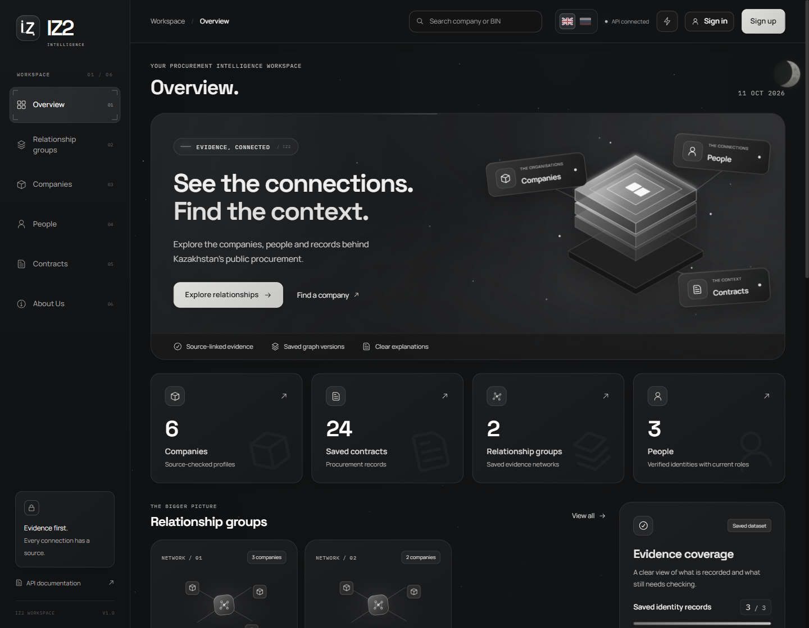
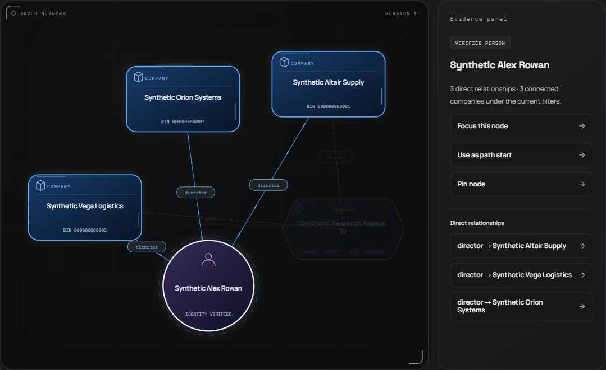
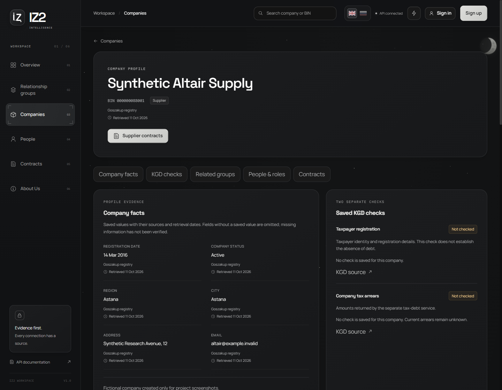
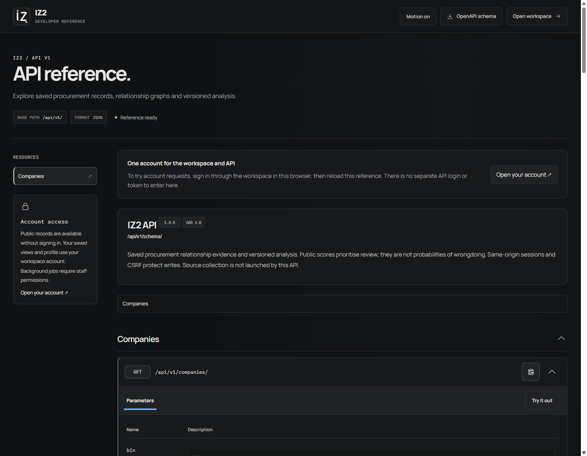

<p align="center">
  
</p>

<h1 align="center">IZ2</h1>

<p align="center">Explore the relationships behind Kazakhstan's public procurement.</p>

<p align="center">
  <a href="#inside-the-workspace">Product tour</a> ·
  <a href="#run-locally">Run locally</a> ·
  <a href="docs/ARCHITECTURE.md">Architecture</a> ·
  <a href="#license">License</a>
</p>

IZ2 brings company, person and contract records into an interactive graph.
Start with a company or a relationship group, follow a shared director or contact,
and inspect the source behind the connection. Saved explanations describe what
the evidence supports and what still needs checking.

I built IZ2 as an independent thesis project. It is intended for procurement
reviewers choosing where to investigate, researchers examining company networks,
and students working with public records. The current prototype supports a
supervised demonstration; a public service is still in preparation.



<sub>Actual IZ2 screens, captured with an isolated fictional dataset. All companies,
people, identifiers, contracts and relationships shown are synthetic.</sub>

## Inside the workspace

| Start here               | What you can do                                                                                                                                |
| ------------------------ | ---------------------------------------------------------------------------------------------------------------------------------------------- |
| **Relationship groups**  | See the reason companies were grouped, their review priority and available evidence. Search by company name or BIN, then filter the results.   |
| **Interactive graph**    | Select a company, person or shared contact; inspect its connections and sources; filter relationship types; open earlier saved versions.       |
| **Companies and people** | Read source-backed fields and retrieval dates. Separate current roles from historical records, and verified identities from unconfirmed names. |
| **Contracts**            | Browse saved procurement records and follow their supplier and customer links.                                                                 |
| **Your account**         | Save, restore or remove graph layouts. Reopen positions, zoom and filters on another device; manage your username and password.                |
| **API reference**        | Explore the versioned JSON API and try requests through locally bundled Swagger UI.                                                            |

The workspace has English and Russian interfaces, keyboard navigation and a
motion toggle. Source values and saved explanation text keep their original
language. The API reference stays in English.

### Follow a connection back to its source

Here, three fictional companies share a verified director; two also share an
address. The graph distinguishes those relationships and keeps the supporting
evidence beside the selected node.



<details>
<summary>See company records and the API reference</summary>

#### Company records

Fields carry source and date information. Taxpayer registration and company tax
arrears appear as separate checks, so a missing debt check remains visible.



#### API reference

The reference uses the same visual language as the workspace. Resource navigation,
filtering and native request controls sit alongside the documented schema.



</details>

## How the evidence works

Existing collectors read the public procurement registry, Adata and authorised
KGD services. Celery processes bounded batches with checkpoints, source pacing
and retry delays. Accepted changes update saved graphs and analyses; unchanged
evidence reuses existing results. Opening a page reads saved state.

Rules calculate review priority. For new explanations, optional local Qwen selects
and orders prepared statements tied to those results; validation rejects unsupported output and saves
a readable template when generation fails. The model does not decide identities,
create graph links or set the public score. Earlier saved explanations retain
their original generation method. See [the explanation design](docs/AI_GROUNDING.md).

A few boundaries matter when reading the results:

- Matching names alone do not establish that two records describe the same person.
- Review priority is an index for manual review. A shared contact or a high score
  does not establish collusion or a violation.
- KGD registration and arrears are separate checks. Failed or unavailable checks
  stay unknown, and a company's debt is not assigned to its director.
- Source coverage varies. Complete ownership history, court, bankruptcy,
  restricted-participant and tender-bid integrations remain future work.

The [data-readiness notes](docs/DATA_READINESS.md) describe source limits;
the [final audit](docs/FINAL_AUDIT.md) and dated follow-ups track release work.

## Architecture

| Layer                  | Implementation                                                        |
| ---------------------- | --------------------------------------------------------------------- |
| Workspace              | React, TypeScript, Vite and D3                                        |
| Application and API    | Python, Django and Django REST Framework                              |
| Evidence and histories | PostgreSQL                                                            |
| Background work        | Celery, Celery beat and Redis                                         |
| Optional local model   | Ollama with Qwen3:4b                                                  |
| Deployment             | One Docker Compose file; optional NVIDIA GPU and Caddy HTTPS profiles |

Django serves the built React workspace and API from one origin. Parsers fetch
and normalise records; ingestion services persist them. Graphs, analyses and
explanations have saved version histories. Accounts store personal views
separately from shared evidence.

## Run locally

For a **new, empty installation**, use Docker with Linux containers, Compose
2.24.4 or newer, and Python 3 for the environment helper. From the repository root:

```sh
python3 scripts/prepare_deploy.py --project iz2 --output .env.docker --ai template
docker compose --env-file .env.docker config --quiet
docker compose --env-file .env.docker up --build -d --wait
docker compose --env-file .env.docker ps -a
```

On Windows, use `python` or `.\.venv\Scripts\python.exe` in place of `python3`.

- Workspace: <http://127.0.0.1:8000/app/>
- API reference: <http://127.0.0.1:8000/api/v1/docs/>
- Readiness: <http://127.0.0.1:8000/health/ready/>

The installation starts empty. The screenshot dataset is not installed, and
collection and automatic model jobs are disabled by default. Source credentials
and collection settings are described in [DEPLOY.md](DEPLOY.md).

Template mode needs no model download. Choose `--ai cpu` when creating the
environment to include local Qwen, or `--ai gpu` on a configured NVIDIA host.
Keep the generated `.env.docker` and its project name; the helper refuses to
overwrite them. Changing the project name selects different volumes.

**Moving an existing database?** Follow the [transfer procedure](DEPLOY.md#transfer-the-native-database-before-starting-the-application)
before the first full startup. The native database is not copied automatically.
The deployment guide also covers HTTPS, backups, updates and shutdown.

<details>
<summary>Native Windows development</summary>

Use Python 3.13+, Node 22.12+, `uv` and a running PostgreSQL instance. Prepare a
private `.env` from [`.env.example`](.env.example). Verify a current backup before
applying migrations to an existing database.

```powershell
uv sync --frozen
.\.venv\Scripts\python.exe manage.py migrate
cd frontend
npm.cmd ci
npm.cmd run build
cd ..
.\.venv\Scripts\python.exe manage.py collectstatic --noinput
.\.venv\Scripts\python.exe manage.py runserver
```

For hot reload, keep Django on port 8000 and run `npm.cmd run dev` from
`frontend/`; open <http://127.0.0.1:5173/>. Restart Django after rebuilding and
collecting production assets.

Local background collection is controlled separately by `scripts/background.ps1`.
Its Start command opts into source collection and local AI jobs; use it only
after configuring the sources and starting local PostgreSQL and Redis:

```powershell
powershell -NoProfile -ExecutionPolicy Bypass -File scripts/background.ps1 -Action Stop
powershell -NoProfile -ExecutionPolicy Bypass -File scripts/background.ps1 -Action Start
powershell -NoProfile -ExecutionPolicy Bypass -File scripts/background.ps1 -Action Status
```

Stop then Start avoids a second collector against the same database. The owned
processes keep running after the terminal closes, but cannot collect while the
laptop sleeps or is off. No Windows autostart task is installed. Use the same
`-Action Stop` command to stop collection; to also stop the helper-owned model:

```powershell
powershell -NoProfile -ExecutionPolicy Bypass -File scripts/local_ai.ps1 -Stop
```

</details>

## Development and verification

Small, focused contributions are welcome. Describe the behaviour you are changing,
use synthetic fixtures, and include a reproducible check. Do not attach private
source responses, credentials or database dumps to issues or pull requests.

<details>
<summary>Run the offline checks</summary>

From the repository root on Windows, after installing the development dependencies:

```powershell
.\.venv\Scripts\python.exe -B manage.py test apps tests --settings=config.test_settings
.\.venv\Scripts\python.exe -B manage.py makemigrations --check --dry-run --settings=config.test_settings
node tests/frontend_regressions.cjs
node tests/graph_interactions.cjs
cd frontend
npm.cmd test -- --maxWorkers=2
npm.cmd run build
npm.cmd run format:check
cd ..
```

These settings do not load `.env` or contact working services. SQLite skips some
PostgreSQL-specific cases; database and concurrency checks need a separate
PostgreSQL test database. Explicit `apps tests` labels exclude the personal
learning file `test.py`. Live sources and model inference are separate checks.

</details>

| Read more                                                          | Contents                                                    |
| ------------------------------------------------------------------ | ----------------------------------------------------------- |
| [Architecture](docs/ARCHITECTURE.md)                               | Module boundaries, evidence flow and versioning             |
| [Frontend](frontend/README.md)                                     | Interface structure and local development                   |
| [Deployment](DEPLOY.md) · [verification](docs/DEPLOYMENT_CHECK.md) | Single-Compose operations and the scope of completed checks |
| [Data readiness](docs/DATA_READINESS.md)                           | Collection stages, identity rules and source coverage       |
| [AI explanations](docs/AI_GROUNDING.md)                            | Prepared statements, validation and fallback                |
| [Roadmap](docs/ROADMAP.md) · [audit](docs/FINAL_AUDIT.md)          | Decisions, remaining work and dated findings                |

## Authors and contact

**Barakhat Mukhtar Batyruly** — project development and thesis work.<br>
[GitHub](https://github.com/XEQU4) · [Email](mailto:b.m.04.11reg@gmail.com) · [Telegram](https://t.me/xequ4w)

**Yestay Arnuruly** — author of the related research article.<br>
[Estay-2020@bk.ru](mailto:Estay-2020@bk.ru)

For a bug report or a proposed change, [open an issue](https://github.com/XEQU4/iz2/issues)
with the affected page, expected behaviour and steps to reproduce it. For private
project enquiries, contact the developer by email.

## License

Original IZ2 code and documentation are licensed under [MIT](LICENSE).
Copyright © 2026 Barakhat Mukhtar Batyruly.

Bundled components, fonts and other third-party material retain their own terms.
React Bits adaptations include the Commons Clause condition; they are not covered
by IZ2's MIT grant. See [third-party notices](THIRD_PARTY_NOTICES.md) and the
[full frontend notice bundle](frontend/public/third-party-notices.txt).
Software licensing does not grant rights to collected source data.
