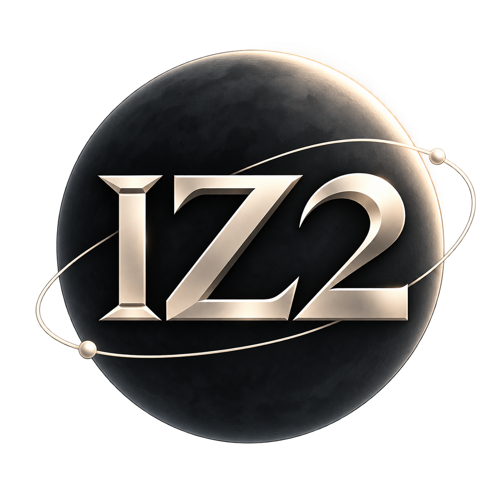
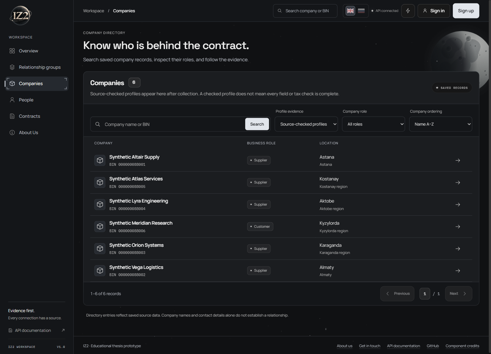

<p align="center"><a href="README.md">English</a> | <a href="README.ru.md">Русский</a></p>

<p align="center"></p>
<h1 align="center">IZ2</h1>
<p align="center">Explore the evidence behind Kazakhstan's public procurement relationships.</p>
<p align="center">
  
  
  
  
  <a href="LICENSE"></a>
</p>

IZ2 is a thesis prototype for researchers and procurement reviewers. It connects saved company, person and contract records so you can explore relationships, inspect their sources and decide what needs further checking.


All screenshots show fictional demonstration data from an isolated database. No working records or credentials are shown; these examples are not installation seeds.

## Features

- **Find participants:** search companies, people and contracts, then inspect source records and dates.
- **Follow connections:** review relationship groups, their supporting evidence and rule-based review priority.
- **Explore the graph:** filter relationships, select nodes and inspect the evidence panel.
- **Revisit saved versions:** compare graph snapshots, group lineage and saved analysis histories.
- **Read explanations:** inspect evidence-bound templates or optional, validated local Qwen explanations.
- **Keep your workspace:** save, restore and delete personal graph layouts; switch the interface between English and Russian.

## Screenshots

**Relationship graph and evidence panel** — a selected fictional director connects three companies.


<details>
<summary>Company directory and API reference</summary>

**Company directory** — search, filters and links to saved profiles.



**API reference** — locally served Swagger documentation, filtered to company endpoints. API docs stay in English.


</details>

## Tech stack

| Layer | Technologies |
| --- | --- |
| Workspace | React 19.3, TypeScript 7, Vite 8, D3 7 |
| Application / API | Python 3.13+, Django 6.0, Django REST Framework 3.17 |
| Data / jobs | PostgreSQL 17, Redis 7, Celery 5.6 / Celery beat |
| Runtime / optional AI | Docker Compose, Gunicorn / WhiteNoise, Ollama / Qwen3:4b |

## Quick start

For a **new, empty installation**, install Git, Python 3.13+ and Docker with Linux containers and Compose 2.24.4+. Node and application dependencies are built inside the image. On Windows, use `python` instead of `python3`.

```sh
git clone https://github.com/XEQU4/iz2.git
cd iz2
python3 scripts/prepare_deploy.py --project iz2 --output .env.docker --ai template
docker compose --env-file .env.docker config --quiet
docker compose --env-file .env.docker up --build -d --wait
docker compose --env-file .env.docker ps -a
```

Open the [workspace](http://127.0.0.1:8000/app/) or [API reference](http://127.0.0.1:8000/api/v1/docs/).

Template mode needs no model download. The database starts empty; collection and automatic AI jobs are off. Keep `.env.docker` private. The helper refuses to overwrite it; preserve the project name because it selects the Docker volumes. For existing native data, follow the [transfer procedure](DEPLOY.md#transfer-the-native-database-before-starting-the-application) before starting the application.

## Documentation

- [Deployment, collection and backups](DEPLOY.md) · [Local development](docs/DEVELOPMENT.md)
- [Architecture](docs/ARCHITECTURE.md) · [Sources and coverage](docs/DATA_READINESS.md)
- [AI explanations](docs/AI_GROUNDING.md) · [Documentation index](docs/README.md)

## Limitations

- A shared contact or connected group does not establish collusion. Review priority is a deterministic index, not a calibrated probability or validated ML detector.
- Source coverage is incomplete. Missing checks do not establish a clean finding; source dates and evidence gaps remain visible.
- This is a supervised thesis prototype, not an unattended public service. Remaining gates are in the [current audit](docs/FINAL_AUDIT.md).

## License and author

Original code and documentation: [MIT](LICENSE), © 2026 [XEQU4](mailto:b.m.04.11reg@gmail.com).

Third-party components and fonts retain their own terms, including **MIT + Commons Clause** for React Bits adaptations. See [third-party notices](THIRD_PARTY_NOTICES.md). Software licensing does not grant rights to external source data.
